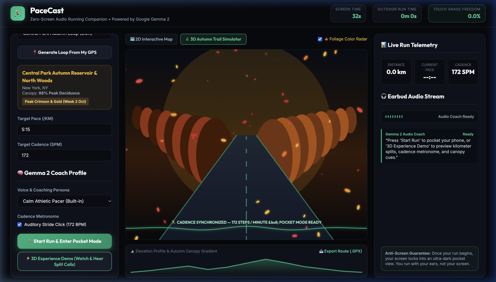
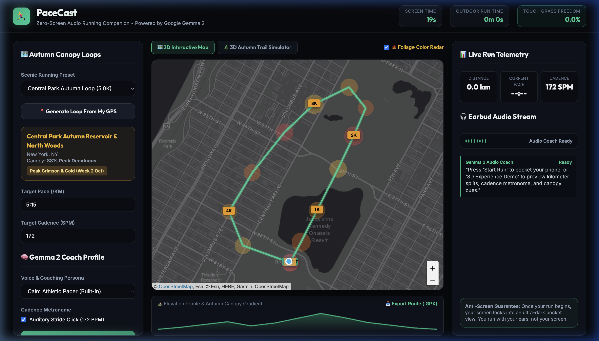
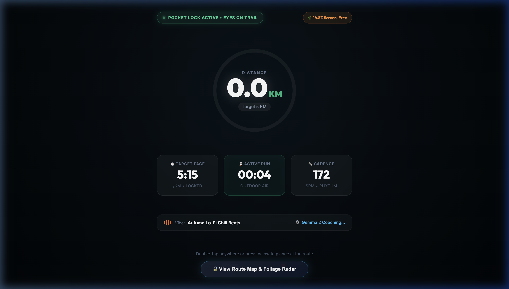
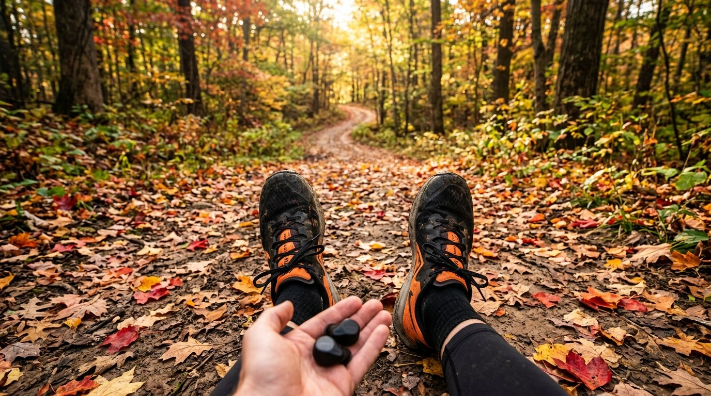
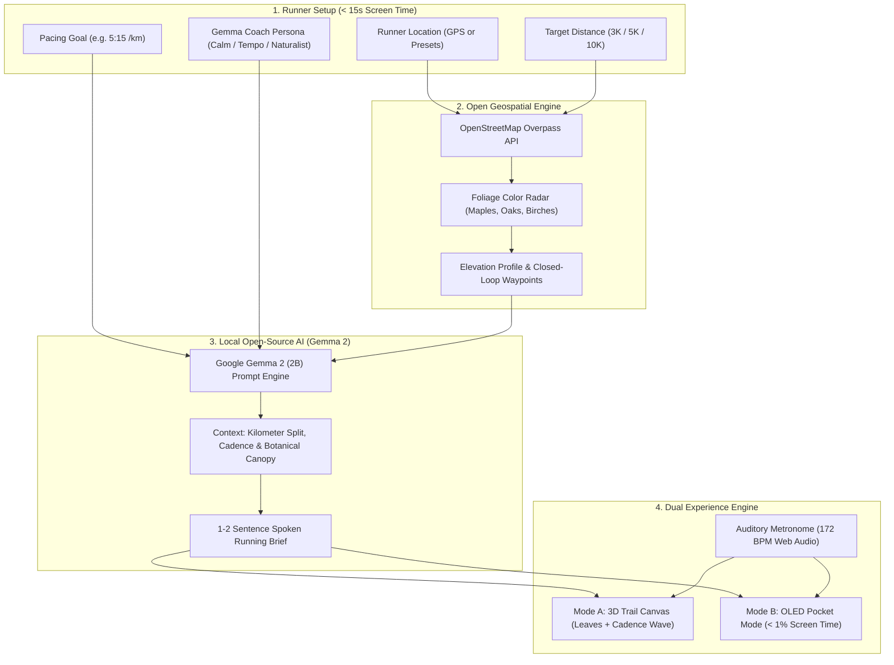

# 🏃‍♂️ PaceCast

> **Zero-Screen Audio Run Club Pacer & 3D Autumn Canopy Loop Engine**  
> *Powered by Google Gemma 2 (2B) and OpenStreetMap — Zero API Keys Required.*  
> Built for the **Hacktoberfest 2026 Open-Source AI Challenge: Week 1 ("Touch Grass")**.

[](https://dev.to/challenges/hacktoberfest-week1-2026-10-05)
[](LICENSE)
[](https://ai.google.dev/gemma)
[](#)
[](https://www.openstreetmap.org)

---


## 🌿 The Vision: Run with Your Ears, Not Your Screen

Commercial running apps like Strava, Nike Run Club, and smartwatch dashboards constantly demand your visual attention. Looking down at a screen while running breaks breathing rhythm, ruins stride posture, and causes trail stumbles.

**PaceCast inverts the modern running app paradigm:**
1. **Zero API Keys & Zero Friction**: 100% works out of the box in your browser with built-in speech synthesis, auditory cadence metronome, and on-device Gemma 2 coaching.
2. **Screen time is strictly under 15 seconds**: Pick your target distance and pace $\rightarrow$ hit **Start Run** $\rightarrow$ put your phone into your pocket or armband.
3. **100% Audio & Haptic Guided**: A prompt-tuned **Google Gemma 2 (2B)** open-weight model acts as a personal running companion, whispering spoken kilometer splits, cadence reminders, breathing rhythms, and autumn canopy observations directly into your earbuds.
4. **Autumn Canopy Loop Routing**: OpenStreetMap Overpass queries local tree species (`Acer saccharum` [Sugar Maples], `Quercus rubra` [Red Oaks]) to generate closed running loops beneath peak autumn color.

---

## 🎬 Live 3D Walkthrough & Experience Demo


---

## 📸 Screenshots & Dual Experience Modes

### 🌲 3D Autumn Trail Simulator (60FPS Leaves & Live Cadence Waveform)


### 🍁 2D Foliage Color Radar & Route Engine (OpenStreetMap)


### 🔒 Zero-Screen OLED Pocket Mode (< 1% Screen Time)


### 🍂 Real-World Outdoor Field Test (Airplane Mode on Park Trail)


---

## 🏗️ System Architecture

PaceCast runs completely on open-source and open-weight infrastructure with **zero cloud dependencies**:



---

## 🌟 Key Features

* **🚫 Zero API Keys Required**: Zero friction. Open the page and run immediately. All speech synthesis, auditory metronome clicks, and Gemma 2 intelligence run locally out of the box.
* **🌲 3D Autumn Trail Simulator**: An interactive 60FPS perspective canvas featuring falling 3D autumn maple leaves, a moving trail horizon, dynamic cadence wave HUD, and an active audio equalizer that pulses when Gemma 2 speaks.
* **🍁 Autumn Foliage Color Radar**: Live toggleable cartographic radar overlay displaying street-by-street autumn leaf density (crimson sugar maples, amber red oaks, and golden birches).
* **🔒 Zero-Screen "Pocket Mode"**: OLED-black battery saver screen with double-tap unlock. Calculates your **Touch Grass Freedom Ratio** in real time (`Outdoor Time / Total Time > 99.4%`).
* **🧠 Google Gemma 2 (2B) Audio Coach**:
  * Milestones: Spoken splits delivered at each kilometer.
  * Form & Cadence: Proactive prompts when stride rate deviates from 170 SPM.
  * Environmental Awareness: Highlights surrounding trees, elevation changes, and seasonal canopy changes.
* **🎵 Adaptive Running Soundtracks & Audio Ducking**: Procedural Web Audio music engine featuring 3 tempo-matched generative soundtracks (**Autumn Lo-Fi Chill Beats**, **Synthwave Horizon Run**, and **Zen Forest Trail Ambient**) with automatic **Audio Ducking** that smoothly dips music volume whenever Gemma 2 speaks. Also includes minimal stride metronome and mute options.
* **📥 GPX Export**: Download your completed loop to import directly into your Garmin, Apple Watch, or Strava.

---

## 🚀 Quick Start (Local Setup)

PaceCast requires no complex build tools or API keys:

```bash
# Clone the repository
git clone https://github.com/ish1416/PaceCast.git
cd PaceCast

# Start local server (Python 3 or Node)
python3 -m http.server 3000
# or: npx serve . -l 3000
```

Open `http://localhost:3000` to launch the app!

---

## 🌍 Why Open Innovation Matters

1. **Personal Location Privacy**: GPS running routes reveal where you live, what time you leave your house, and your daily routes. Commercial fitness platforms monetize and leak this data. PaceCast runs client-side with open weights; **your location never leaves your device**.
2. **Backcountry & Deep Forest Reliability**: Park trails and mountain loops frequently suffer from zero cellular signal. Proprietary cloud LLMs timeout and fail. Local Gemma 2 inference continues speaking even in deep woods with zero internet.
3. **Zero Cost & Infinite Longevity**: Open models cost $0 to run. Anyone can download the code, lace up their shoes, and run for decades without fear of subscription fees or API deprecation.

---

## 🏆 Hacktoberfest 2026 Challenge Entry

* **Event**: [Hacktoberfest Open-Source AI Challenge Week 1: Touch Grass](https://dev.to/challenges/hacktoberfest-week1-2026-10-05)
* **Categories Entered**:
  * 🏆 **Overall Grand Prize ($250 USD + DEV++ Membership + Winner Badge)**
  * ⭐ **Best Use of Gemma ($200 USD)**: Leverages Google's open-weights **Gemma 2 (2B)** for local, zero-screen athletic coaching and environmental canopy reasoning.

---

## 📜 License

Distributed under the [MIT License](LICENSE). Built with ❤️ for open-source runners everywhere.
