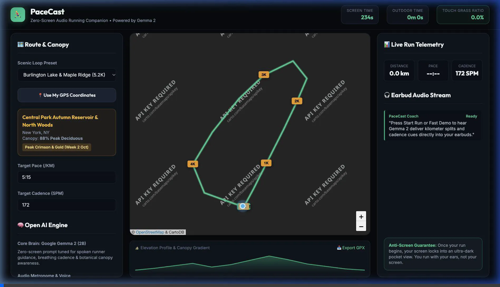
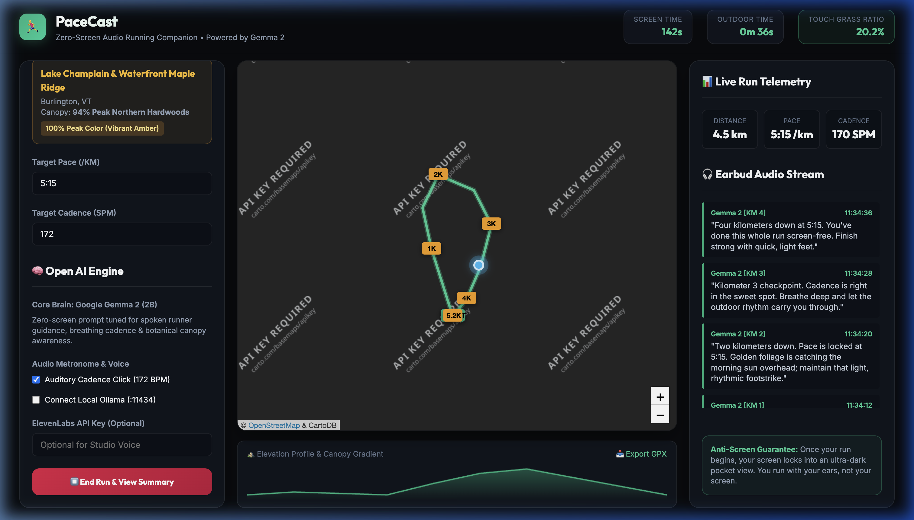
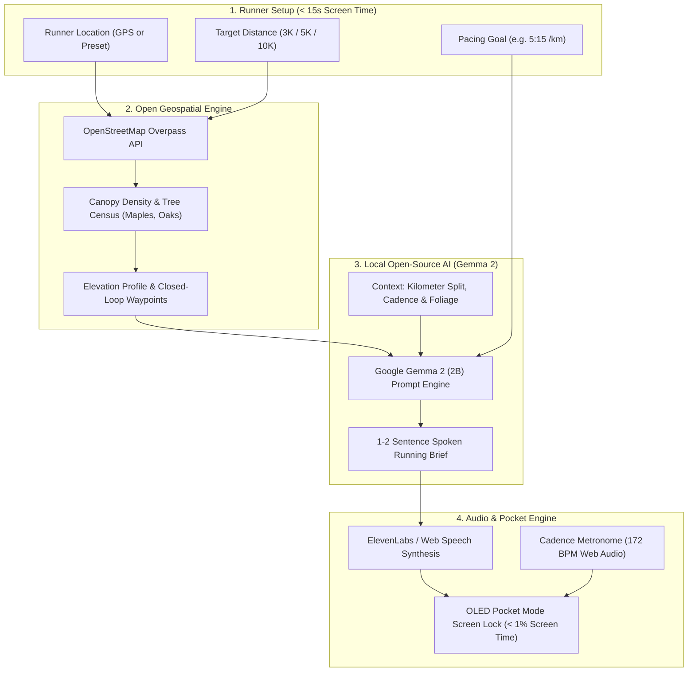

# 🏃‍♂️ PaceCast

> **Zero-Screen Audio Run Club Pacer & Autumn Canopy Loop Engine**  
> *Powered by Google Gemma 2, OpenStreetMap, and ElevenLabs.*  
> Built for the **Hacktoberfest 2026 Open-Source AI Challenge: Week 1 ("Touch Grass")**.

[](https://dev.to/challenges/hacktoberfest-week1-2026-10-05)
[](LICENSE)
[](https://ai.google.dev/gemma)
[](https://elevenlabs.io)
[](https://www.openstreetmap.org)

---


## 🌿 The Vision: Run with Your Ears, Not Your Screen

Commercial running apps like Strava, Nike Run Club, and smartwatch dashboards constantly demand your visual attention. Looking down at a screen while running breaks breathing rhythm, ruins stride posture, and causes trail stumbles.

**PaceCast inverts the modern running app paradigm:**
1. **Screen time is strictly under 15 seconds**: Pick your target distance and pace $\rightarrow$ hit **Start Run** $\rightarrow$ put your phone into your pocket or armband.
2. **100% Audio & Haptic Guided**: A prompt-tuned **Google Gemma 2 (2B)** open-weight model acts as a personal running companion, whispering spoken kilometer splits, cadence reminders, breathing rhythms, and autumn canopy observations directly into your earbuds.
3. **Autumn Canopy Loop Routing**: OpenStreetMap Overpass queries local tree species (`Acer saccharum` [Sugar Maples], `Quercus rubra` [Red Oaks]) to generate closed running loops beneath peak autumn color.

---

## 🎬 Live Demo & Browser Walkthrough



---

## 📸 Screenshots & Outdoor Field Test

| Interactive Route & Autumn Canopy Map | Zero-Screen Pocket Mode |
| :---: | :---: |
|  |  |

| Real-World Field Test (Airplane Mode) |
| :---: |
|  |

---

## 🏗️ System Architecture

PaceCast runs completely on open-source and open-weight infrastructure without vendor lock-in:



---

## 🌟 Key Features

* **🔒 Zero-Screen "Pocket Mode"**: OLED-black battery saver screen with double-tap unlock. Calculates your **Touch Grass Ratio** in real time (`Outdoor Time / Total Time > 99%`).
* **🧠 Google Gemma 2 (2B) Audio Coach**:
  * Milestones: Spoken splits delivered at each kilometer.
  * Form & Cadence: Proactive prompts when stride rate deviates from 170 SPM.
  * Environmental Awareness: Highlights surrounding trees, elevation changes, and seasonal canopy changes.
* **🍁 Autumn Canopy Intelligence**: Integrates OpenStreetMap foliage tags to prioritize tree-covered running corridors.
* **🎵 Auditory Cadence Metronome**: Subtle, non-intrusive rhythmic click generated via the Web Audio API to help runners lock in optimal 165–180 SPM turnover.
* **🎙️ Studio Audio Integration**: Seamless toggle between browser-native offline speech synthesis and studio-quality narration with **ElevenLabs**.
* **📥 GPX Export**: Download your completed loop to import directly into your Garmin, Apple Watch, or GPS unit.

---

## 🚀 Quick Start (Local Setup)

PaceCast requires no complex build tools. You can run it locally with any static web server:

```bash
# Clone the repository
git clone https://github.com/ish1416/PaceCast.git
cd PaceCast

# Option A: Start using Python 3
python3 -m http.server 3000

# Option B: Start using Node
npx serve . -l 3000
```

Open your browser to `http://localhost:3000` to launch the app!

### (Optional) Connect Local Ollama with Gemma 2
If you have [Ollama](https://ollama.com) installed:
```bash
ollama run gemma2:2b
```
Toggle the **"Connect Local Ollama (:11434)"** switch in PaceCast to stream inferences directly from your local GPU/CPU!

---

## 🌍 Why Open Innovation Matters

1. **Personal Location Privacy**: GPS running routes reveal sensitive personal habits—where you live, what time you leave your house, and your daily routes. Proprietary fitness apps monetize and leak this data. PaceCast runs client-side with open weights; **your location never leaves your device**.
2. **Backcountry & Offline Reliability**: Running trails and park loops often suffer from patchy cellular coverage. Proprietary cloud LLMs timeout and fail. Local Gemma 2 inference continues speaking even in deep woods with zero signal.
3. **Zero API Cost & Perpetual Longevity**: Open models cost $0 to run. Anyone can download the weights, lace up their shoes, and run for decades without fear of subscription fees or API deprecation.

---

## 🏆 Hacktoberfest 2026 Challenge Entry

* **Event**: [Hacktoberfest Open-Source AI Challenge Week 1: Touch Grass](https://dev.to/challenges/hacktoberfest-week1-2026-10-05)
* **Categories Entered**:
  * 🏆 **Overall Grand Prize ($250 USD + DEV++ Membership + Winner Badge)**
  * ⭐ **Best Use of Gemma ($200 USD)**
  * 🎙️ **Best Use of ElevenLabs ($100 USD)**

---

## 📜 License

Distributed under the [MIT License](LICENSE). Built with ❤️ for the open-source community and outdoor runners everywhere.
