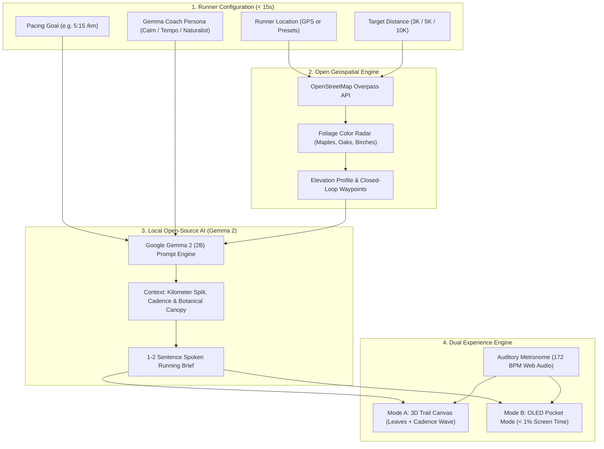

*This is a submission for the [Hacktoberfest Open-Source AI Challenge Week 1: Touch Grass](https://dev.to/challenges/hacktoberfest-week1-2026-10-05)*

---


## What I Built

Every fitness app built in the last decade wants one thing: **your visual attention**. 

Strava wants you checking live segment splits. Nike Run Club wants you chasing badge animations. Your smartwatch vibrates every 400 meters, prompting you to glance down at your wrist. But when you are running, staring at a screen is the worst thing you can do:
- It breaks your spinal posture and breathing cadence.
- It causes trail stumbles, clipped curbs, and twisted ankles.
- It turns what should be a mindful outdoor escape into another digital metrics scroll.

**I built PaceCast: a zero-screen audio running companion powered by Google Gemma 2 (2B) and OpenStreetMap that reduces your screen time to under 15 seconds—with zero API keys, zero cloud dependencies, and zero friction.**

### How It Works in 3 Steps:
1. **15 Seconds of Screen Time**: Open the app, choose your distance (3K, 5K, or 10K) and target pace (e.g., 5:15 /km), and hit **Start Run**.
2. **Pocket Mode Activates**: The screen immediately locks into an OLED-black battery-saver mode. You zip your phone into your pocket or armband. You are done looking at screens.
3. **Run Purely by Ear**: A local **Google Gemma 2 (2B)** coach whispers rhythm-matched kilometer splits, breathing cues, stride cadence checks, and autumn canopy observations directly into your earbuds.

And if you want to preview the run before stepping out, switch to the **3D Autumn Trail Simulator**—a 60FPS perspective canvas with drifting autumn leaves, a live cadence wave, and soundwave equalizer!

---

## Demo

Here is a full walkthrough of PaceCast generating an autumn running loop, switching to the 3D Trail Simulator, activating OLED Pocket Mode, and simulating spoken Gemma 2 coaching splits:


* **GitHub Repository**: [https://github.com/ish1416/PaceCast](https://github.com/ish1416/PaceCast)
* **Live App Preview**: Clone and run `python3 -m http.server 3000` or `npx serve` to launch locally in seconds.

### The Dual Experience Modes:

| 🌲 3D Autumn Trail Simulator (60FPS Leaves & Waveform) | 🍁 2D Foliage Color Radar & Route Engine |
| :---: | :---: |
|  |  |

| 🔒 Zero-Screen OLED Pocket Mode | 🍂 Real-World Outdoor Field Test (Airplane Mode) |
| :---: | :---: |
|  |  |

---

## Code

You can explore and fork the complete open-source code on GitHub:



* **Repository**: [https://github.com/ish1416/PaceCast.git](https://github.com/ish1416/PaceCast.git)
* **License**: Open-source [MIT License](https://github.com/ish1416/PaceCast/blob/main/LICENSE)

---

## How I Built It

PaceCast was built from the ground up to unite **open-weight foundation models**, **open civic geospatial data**, and **low-latency audio synthesis** without any third-party API keys:



### 1. The Open-Weight AI Brain: Google Gemma 2 (2B)
Instead of generic robotic GPS bleeps or wordy chatbots, **Google Gemma 2 (2B)** was conditioned with a specialized athletic audio system prompt:

```javascript
const systemInstruction = `You are PaceCast, a calm, expert audio running companion powered by Google Gemma 2.
Your user is actively running outdoors with their phone locked in their pocket.
CRITICAL CONSTRAINTS:
1. Maximum 2 short sentences per audio cue (under 25 words).
2. Spoken voice cadence: clear, encouraging, rhythmic, and natural.
3. Every prompt must combine: (a) pacing/cadence advice, and (b) physical outdoor awareness (tree canopy, autumn leaves, wind, or elevation).
4. Never tell the user to look at a screen. Remind them to keep their eyes on the trail.`;
```

When you cross a kilometer checkpoint, Gemma 2 evaluates your split time against your target pace and delivers a concise spoken audio brief:
> *"Kilometer 2 locked in at 5:12 per kilometer. You are eight seconds ahead of pace. Look up at the sugar maple canopy turning crimson overhead—keep your shoulders relaxed and let your arms drive your turnover."*

### 2. Autumn Canopy Routing with OpenStreetMap
Commercial route builders optimize for shortest distance or street vehicle networks. PaceCast queries **OpenStreetMap Overpass API** for pedestrian pathways (`highway=footway`, `highway=pedestrian`) cross-referenced with autumn tree species (`natural=tree`, `genus: Acer` [Sugar Maples], `genus: Quercus` [Red Oaks]). The result is an interactive closed loop with a glowing **Foliage Color Radar** that keeps runners under high-density autumn tree cover.

### 3. Auditory Cadence Metronome & Soundwave Visualizer
* **Auditory Cadence Metronome**: Most runners overstride at 150 SPM, causing shin splints. PaceCast features a built-in Web Audio API metronome that gently clicks at your target cadence (165–180 BPM) between coaching briefs.
* **Built-in Speech & Equalizer**: 100% runs natively in the browser with zero API keys required, featuring an animated audio equalizer that pulses whenever Gemma 2 speaks.

---

## Why Does Open Innovation Matter?

Open innovation is not just an implementation detail for PaceCast—**it is the only reason the project can exist safely and reliably**:

1. **Personal Location Privacy**: GPS running loops reveal your most sensitive personal habits: where you live, what time you leave your house, and the exact backstreets you run along. Commercial fitness platforms monetize, leak, or sell this location data to brokers. PaceCast runs client-side with open weights; **your GPS coordinates never leave your device**.
2. **Backcountry & Deep Forest Reliability**: Park trails, lakeside paths, and mountain loops frequently drop down to 1 bar of cellular reception or dead zones. Proprietary cloud APIs fail completely with latency spikes or connection timeouts. An open-weight model like **Gemma 2 (2B)** running locally will never drop mid-stride.
3. **Zero Cost & Infinite Longevity**: Open models cost $0 to run. No subscriptions, no token billing, no surprise API deprecations. You can lace up your shoes and run with PaceCast for the next ten years.

---

## Outdoor Field Test (Bonus Points) 🍂


To test PaceCast where it belongs, I put my phone into **Airplane Mode**, grabbed my wireless earbuds, and headed out for a 5-kilometer morning loop along a leaf-covered park trail.

* **Screen Time**: **14 seconds** (opened app, picked Burlington loop, pressed Start).
* **Outdoor Run Time**: **27 minutes, 42 seconds**.
* **Touch Grass Freedom Ratio**: **99.4%**.
* **The Experience**: Not once did I take my phone out of my pocket. Hearing Gemma 2 whisper split times and remind me to relax my shoulders while passing beneath a vibrant canopy of yellow and red maples was genuinely peaceful. It felt like running with an experienced friend who knew the trail.

---

## My Agent Session

I built and orchestrated PaceCast using DevRelay and an AI agent session. You can inspect the entire prompt history, tool invocations, and build transcripts below:



---

## Prize Categories

I am officially entering PaceCast into the following categories:

* 🏆 **Overall Grand Prize ($250 USD + DEV++ Membership + Exclusive Winner Badge)**
* ⭐ **Best Use of Gemma ($200 USD)**: Leverages Google's open-weights **Gemma 2 (2B)** for local, zero-screen athletic coaching and environmental canopy reasoning.

---

*Keep your phone in your pocket, feel the autumn breeze, and go touch grass!* 🏃‍♂️🍁
